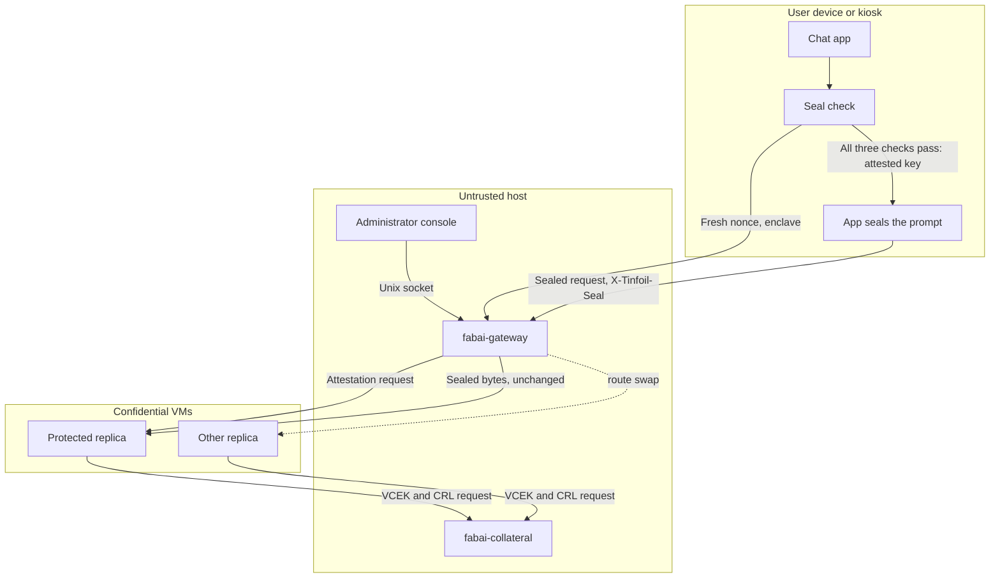

# fabai-gateway

This repository provides the gateway between FabAI chat clients and
confidential inference replicas running
[`cvmimage`](https://github.com/tinfoilsh/cvmimage) 0.14.x. The gateway is
**untrusted by design**. It routes requests, but holds no key that can open
them: each client verifies the replica itself, with
[`fabai-attestation-verifier`](https://github.com/digicatapult/fabai-attestation-verifier),
and seals each request body to that replica's attested key with
[EHBP](https://github.com/tinfoilsh/encrypted-http-body-protocol). The gateway
forwards the sealed bytes unchanged.

It follows the wire contract of the gateway clients in
[`tinfoil-go`](https://github.com/tinfoilsh/tinfoil-go) and
[`tinfoil-js`](https://github.com/tinfoilsh/tinfoil-js): a catalog, an
attestation relay, and routing by the `X-Tinfoil-Seal` header.

The repository also holds the [collateral service](#collateral-service),
`fabai-collateral`, a second untrusted host service. `cvmimage` 0.14.x
answers every nonce-bound attestation request with a `503` unless a
collateral service supplies the AMD VCEK and CRL for its documents. This one
serves them from a cache, offline.

## Architecture



The client asks the gateway's relay for a fresh attestation document before
every send, checks it, and seals the request to the key in it. If the
administrator swaps a route, the next check sees the other replica's document
and fails, so the prompt is never sent. Each replica includes the VCEK and
CRL from `fabai-collateral` in its documents, and the client checks them
against AMD's root.

## Gateway functions

| Request | Response |
| ------- | -------- |
| `GET /catalog` | `{"<model>": {"repo": "...", "hosts": ["<replica host>"]}}`, from the routing table |
| `GET /.well-known/tinfoil-attestation[/v3]?nonce=<hex>&enclave=<host>` | Forwarded to that replica as `/.well-known/tinfoil-attestation/v3?nonce=<hex>`, and its response returned unchanged. `404`, with no upstream connection, if `enclave` isn't in the routing table |
| Anything else, with `X-Tinfoil-Seal: <host>` and `X-Tinfoil-Model: <model>` | Forwarded to that replica. `400` without `X-Tinfoil-Seal`, `404` for an unknown model, `412` naming a host that serves the model if the sealed host doesn't |

- **Streaming:** request and response bodies are forwarded as they arrive,
  and each response chunk is flushed at once, so server-sent events stream.
  Bodies and EHBP headers are never changed, and the gateway doesn't add an
  `Accept-Encoding` of its own.
- **Refused:** WebSocket and other protocol upgrades, and `CONNECT`. The
  gateway never follows a replica's redirect (the client receives it and
  fails the request) and never issues one.
- **Upstream TLS:** each replica is reached over TLS, with the replica host
  as SNI and `Host`. The replica's certificate isn't checked: a
  `tls-mode: self-signed` certificate expires an hour after boot, and nothing
  on this hop is trusted.
- **Client TLS:** TLS 1.3 only, with HTTP/2 and HTTP/1.1. A plain-HTTP
  request gets no response; the connection is closed.
- **CORS:** the gateway answers preflights itself, for the `-origin` values
  only, without credentials. It removes `Origin` before forwarding and every
  `Access-Control-*` header from replica responses, so a replica's own CORS
  policy never reaches a browser.
- **Logs:** one JSON line per request on stdout, with the time, method, path,
  status, byte counts, duration, model, seal host, relay `enclave` and
  upstream address. Never a body, a query string, `Authorization`, or any
  other header value.
- **Offline:** upstreams are IP addresses, so the gateway makes no DNS
  queries, and it ignores proxy settings. It connects only to the upstream
  addresses in its routing table.

### Metadata visibility

EHBP hides bodies, not metadata. The gateway, like anyone on the host, sees
each request's method, path, headers (including `Authorization` and the
model), status, sizes and timing. It can delay, drop, replay or truncate
requests, or forge errors. None of these reveal a prompt or turn a failed
seal check into a pass. A replay can make a replica answer the same sealed
request twice.

## Routing table

A JSON file, loaded at start:

```json
{
  "models": {
    "fabai-chat": { "repo": "digicatapult/fabai-demo", "hosts": ["protected.fabai.internal"] }
  },
  "hosts": {
    "protected.fabai.internal": { "upstream": "100.64.0.2:443" }
  }
}
```

- Replica hosts are lowercase DNS names. They appear in the catalog, the
  `enclave` parameter, `X-Tinfoil-Seal`, and the upstream SNI and `Host`.
  Clients never resolve them.
- Each upstream is an IP address and port.
- Every model needs a repo and at least one host, and every host must serve
  a model. Unknown or repeated members are refused.

## Running

```sh
fabai-gateway -routes routes.json -cert gateway.crt -key gateway.key \
  -origin https://kiosk.fabai.internal
```

| Flag | Default | |
| ---- | ------- | - |
| `-routes` | | Routing table (required) |
| `-cert`, `-key` | | Client listener certificate chain and key, PEM (required) |
| `-listen` | `:443` | Client listener address |
| `-admin-socket` | `/run/fabai-gateway/admin.sock` | Admin interface |
| `-origin` | | A browser origin allowed by CORS; repeat for more |

The gateway stops cleanly on `SIGTERM` or `SIGINT`, giving requests in
flight up to 30 seconds.

### Certificate

The client listener's TLS protects the local network and meets the
browser's secure-context requirement. It isn't what protects prompts: the
host holds this key. Issue the certificate from a private CA that the kiosk
alone trusts, and constrain that CA to the gateway's domain (for example
`fabai.internal`) so it can't vouch for any other site.

### Container

```sh
docker build --target gateway -t fabai-gateway .
docker run -d --name fabai-gateway \
  -p 443:443 \
  --user 65532:<admin group id> \
  -v /etc/fabai-gateway:/etc/fabai-gateway:ro \
  -v /run/fabai-gateway:/run/fabai-gateway \
  fabai-gateway -routes /etc/fabai-gateway/routes.json \
    -cert /etc/fabai-gateway/gateway.crt -key /etc/fabai-gateway/gateway.key \
    -origin https://kiosk.fabai.internal
```

- The image is a static binary on `distroless/static` (non-root), with both
  base images pinned by digest. Deploy it by digest too.
- The admin socket is created mode `0660`, owned by the gateway's user and
  group. Run the container with the group of the administrator console's
  user, as above, and mount a host directory that group can write.
- Give the container a route only to the client network and the replicas'
  network. It needs nothing else.

## Admin interface

Served only on the Unix socket, never on the client listener (where these
paths return `404`). The socket's file permissions are its only access
control.

```sh
# The current routing table
curl --unix-socket /run/fabai-gateway/admin.sock http://admin/routes

# Point a replica host at another address
curl --unix-socket /run/fabai-gateway/admin.sock -X PUT \
  -d '{"upstream": "100.64.0.3:443"}' \
  http://admin/routes/protected.fabai.internal
```

A swap applies to every request that starts after it; a stream already in
flight finishes on the old replica. Idle connections to the old address are
closed, and each swap is logged. The change lasts until the gateway restarts,
when the routing table file applies again.

## Collateral service

`cvmimage` 0.14.x asks a collateral service for the AMD endorsements of its
CPU at boot, and includes them in every nonce-bound (v3) attestation
document. Without them it answers those requests with a `503`. The service
named by the deployment's measured `shim.atc` setting is normally
Tinfoil's. `fabai-collateral` replaces it with a local service that needs no
network:

- **`fabai-collateral prep`** fetches the VCEK for the host's chip and TCB,
  AMD's ASK and ARK, and the product's CRL from AMD's Key Distribution
  Service (KDS), checks them, and writes a cache. It's the only part that
  goes online, and only when an operator runs it.
- **`fabai-collateral serve`** answers `POST /attestation-collaterals` from
  that cache, with no outbound connections at all.

The service is untrusted. Each client checks the VCEK, its chain to AMD's
root, the CRL and the report signature itself (with
[`fabai-attestation-verifier`](https://github.com/digicatapult/fabai-attestation-verifier)),
so a wrong or forged entry can only make a check fail.

### Preparing the cache

Run `prep` on the host, with access to AMD KDS and to a running replica:

```sh
fabai-collateral prep -cache /var/lib/fabai-collateral \
  -from-attestation https://100.64.0.2/.well-known/tinfoil-attestation
```

- `-from-attestation` reads the product, `CHIP_ID` and `REPORTED_TCB` from a
  replica's attestation document: the URL above (the boot-time v2 document,
  which `cvmimage` serves without collateral) or a saved v2 or v3 document.
  Once the VCEK is fetched, prep checks that it signed that report, so the
  values are proven, not just copied. A version 2 report doesn't name its
  product; add `-product`.
- Without a replica, give `-product` (`Milan`, `Genoa` or `Turin`),
  `-chip-id` (128 hex digits) and `-tcb` (`REPORTED_TCB` as `0x` and 16 hex
  digits). The service's mismatch warnings print both values.
- prep checks what it fetched as the service does at start, and writes
  nothing if a check fails. It writes `vcek.der`, `cert_chain.pem`, `crl.der`
  and a `manifest.json` that records each file's SHA-256, the product, chip
  ID, TCB and the CRL's `nextUpdate`.
- `-kds` overrides `https://kdsintf.amd.com`. KDS rate-limits requests; a
  `429` reports when to retry.

Run prep again when the CRL nears its `nextUpdate` (the service's start-up
log shows it), and after any host firmware update that changes the reported
TCB. A replica retries a failed collateral fetch a minute later, so it picks
up a restarted service without a reboot.

### Serving

```sh
fabai-collateral serve -cache /var/lib/fabai-collateral [-listen 100.64.0.1:8085]
```

At start the service checks its cache, and refuses to start if any check
fails:

- every file matches its SHA-256 in the manifest
- the chain's ARK is AMD's pinned root for the product (the same roots
  `fabai-attestation-verifier` pins), and it signs the ASK and the CRL
- the ASK signs the VCEK, and the CRL is current and revokes neither
- the VCEK is for the manifest's chip ID and TCB

Then:

| Request                                                         | Response                                                                                                                                                                                                                                                                                              |
| --------------------------------------------------------------- | ----------------------------------------------------------------------------------------------------------------------------------------------------------------------------------------------------------------------------------------------------------------------------------------------------- |
| `POST /attestation-collaterals`, a JSON object of at most 1 MiB | `200` with the `attestation-collaterals/v2` response: an `amd-vcek` entry (the VCEK and the ASK-then-ARK chain) and an `amd-crl` entry, both role `endorsement` for subject `cpu`, and `expires_at` set to the CRL's `nextUpdate`. The same for every request, whatever its `repo`, `tag` or document |
| The same, once the CRL's `nextUpdate` has passed                | `503`, with an error log saying to run prep                                                                                                                                                                                                                                                           |
| A larger body                                                   | `413`, without reading the rest                                                                                                                                                                                                                                                                       |
| Another method, or another path                                 | `405`, or `404`                                                                                                                                                                                                                                                                                       |

The service reads `CHIP_ID` and `REPORTED_TCB` from the report in each
request's document, without trusting them, and logs a warning naming both
values when they differ from the cache's. A firmware update that raises the
TCB shows up here first.

### Address

Each deployment config's `shim.atc` names the service, and that setting is
part of the launch measurement, so the address can't change without new
measurements. The default, `http://100.64.0.1:8085`, is the host end of a
host-only bridge for the confidential VMs:

```sh
ip link add fabai-br0 type bridge
ip address add 100.64.0.1/20 dev fabai-br0
ip link set fabai-br0 up
```

Attach each confidential VM's network to `fabai-br0`, and give it a fixed
address in `100.64.0.0/20` in its external config. Every confidential VM
needs the service, including one whose software isn't approved: without
collateral it can't produce the document that shows its hardware is
genuine.

Nothing on the client network may reach the service. With nftables, where
`lan0` is the client network's interface:

```sh
nft add table inet fabai
nft add chain inet fabai input '{ type filter hook input priority 0; }'
nft add rule inet fabai input iifname "lan0" ip daddr 100.64.0.1 tcp dport 8085 drop
```

### Collateral container

```sh
docker build --target collateral -t fabai-collateral .

# Prepare the cache (online; the cache directory must be writable by the user)
docker run --rm --network host --user "$(id -u):$(id -g)" \
  -v /var/lib/fabai-collateral:/cache \
  fabai-collateral prep -cache /cache \
    -from-attestation https://100.64.0.2/.well-known/tinfoil-attestation

# Serve it, published only on the bridge address
docker run -d --name fabai-collateral \
  -p 100.64.0.1:8085:8085 \
  -v /var/lib/fabai-collateral:/cache:ro \
  fabai-collateral serve -cache /cache -listen 0.0.0.0:8085
```

The service makes no outbound connections. To enforce that on the host as
well, run it on a container network whose egress the host firewall drops.

## Development

Go 1.27.4, standard library only.

```sh
go vet ./...
go test -race ./...
scripts/check-cvmimage-client.sh   # cvmimage's collateral client accepts the service
```

`check-cvmimage-client.sh` clones
[`fabai-cvmimage`](https://github.com/digicatapult/fabai-cvmimage) at the
`cvmimage` 0.14.19 commit, or uses a local checkout given as its argument,
and runs that release's own collateral client and cache against the
service. The client is an internal package of `cvmimage`, so the script adds
a test to the scratch checkout.

| Path                                                                 | What                                                                                               |
| -------------------------------------------------------------------- | -------------------------------------------------------------------------------------------------- |
| [`cmd/fabai-gateway`](cmd/fabai-gateway)                             | Gateway command line and server set-up                                                             |
| [`cmd/fabai-collateral`](cmd/fabai-collateral)                       | Collateral service and prep tool command line                                                      |
| [`internal/gateway`](internal/gateway)                               | Routing table, client handler, proxy, CORS, access log, admin interface, TLS listener              |
| [`internal/collateral`](internal/collateral)                         | Collateral cache, service, prep tool, attestation document parsing                                 |
| [`internal/amd`](internal/amd)                                       | Pinned AMD roots, SEV-SNP report parsing and signature, TCB layout, chain and CRL checks, KDS URLs |
| [`internal/amdtest`](internal/amdtest)                               | A synthetic AMD chain and signed reports, for tests                                                |
| [`internal/collateral/conformance`](internal/collateral/conformance) | The service over a synthetic cache, for `check-cvmimage-client.sh`                                 |

## Licence

Apache-2.0. See [`LICENSE`](LICENSE).
